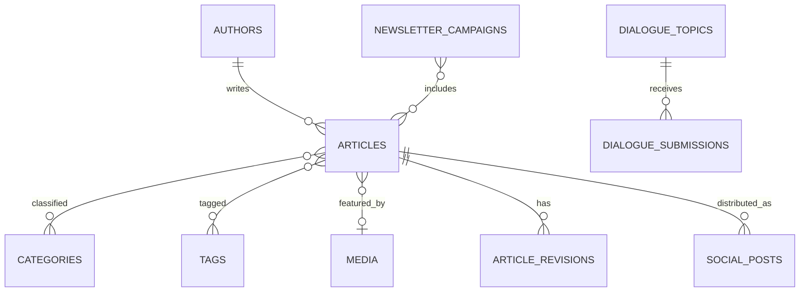

# Database and Content Model

Use conventional Laravel migrations, foreign keys, indexes, soft deletes where appropriate and explicit unique constraints.

## 1. Core tables

### users
- id
- name
- email
- password
- status
- last_login_at
- timestamps

### roles / permissions
Use a proven role/permission implementation or equivalent explicit policy model.

### authors
Authors should be separable from login users because historical article authors may not need accounts.

- id
- user_id nullable
- name
- slug unique
- title/designation nullable
- bio nullable
- photo_media_id nullable
- email nullable/private
- social_links json nullable
- is_active
- timestamps

### articles
- id
- legacy_wp_id nullable indexed
- author_id
- title
- subtitle nullable
- slug unique
- excerpt nullable
- body longtext
- status indexed
- featured_media_id nullable
- default_image_used boolean
- seo_title nullable
- meta_description nullable
- canonical_url nullable
- robots_index boolean default true
- robots_follow boolean default true
- social_title nullable
- social_description nullable
- social_media_id nullable
- allow_comments boolean
- show_view_count boolean
- featured boolean
- featured_weight integer default 0
- published_at nullable indexed
- scheduled_at nullable indexed
- updated_content_at nullable
- legacy_url nullable
- created_by
- updated_by
- timestamps
- soft_deletes

### categories
- id
- legacy_wp_id nullable
- parent_id nullable
- name
- slug unique
- description nullable
- featured_media_id nullable
- seo_title nullable
- meta_description nullable
- timestamps

### article_category
- article_id
- category_id
- composite unique

### tags
- id
- legacy_wp_id nullable
- name
- slug unique
- description nullable
- timestamps

### article_tag
- article_id
- tag_id
- composite unique

### media
- id
- legacy_wp_id nullable
- disk
- path
- original_filename
- mime_type
- size_bytes
- width nullable
- height nullable
- title nullable
- alt_text nullable
- caption nullable
- credit nullable
- focal_point_x nullable
- focal_point_y nullable
- metadata json nullable
- uploaded_by nullable
- timestamps

### pages
- id
- legacy_wp_id nullable
- title
- slug unique
- body
- excerpt nullable
- template nullable
- status
- featured_media_id nullable
- seo_title nullable
- meta_description nullable
- canonical_url nullable
- published_at nullable
- legacy_url nullable
- timestamps

## 2. Publishing support

### article_revisions
- id
- article_id
- user_id
- snapshot json
- reason nullable
- created_at

### redirects
- id
- from_path unique
- to_url
- http_status default 301
- hits default 0
- last_hit_at nullable
- is_active
- timestamps

### article_views
For privacy-aware internal counts.

- id
- article_id
- viewed_on date
- views
- unique_estimate nullable
- timestamps

Aggregate rather than permanently storing raw visitor IPs.

### search_queries
Optional.
- id
- query
- result_count
- searched_at
- anonymous/session hash optional with retention limits

## 3. Newsletter

### newsletter_subscribers
- id
- email unique
- name nullable
- status (pending/active/unsubscribed/bounced)
- interests json nullable
- source nullable
- consented_at nullable
- confirmed_at nullable
- unsubscribed_at nullable
- provider_contact_id nullable
- timestamps

### newsletter_campaigns
- id
- title
- subject
- preview_text nullable
- body
- status
- provider nullable
- provider_campaign_id nullable
- scheduled_at nullable
- sent_at nullable
- created_by
- timestamps

### newsletter_campaign_article
- campaign_id
- article_id

## 4. Dialogue Room

### dialogue_topics
- id
- title
- prompt
- description nullable
- slug unique
- status
- opens_at nullable
- closes_at nullable
- featured
- timestamps

### dialogue_submissions
- id
- dialogue_topic_id nullable
- name
- phone nullable
- email nullable
- contribution text
- consent boolean
- status (new/reviewed/approved/published/rejected/spam)
- published_slug nullable
- reviewed_by nullable
- reviewed_at nullable
- timestamps

## 5. Membership

### membership_applications
Support fields present in the legacy form, including:

- id
- reference_code unique
- photo_media_id nullable
- title
- full_name
- date_of_birth nullable
- nationality nullable
- state_province nullable
- lga nullable
- contact_address nullable
- phone
- email
- occupation nullable
- organization nullable
- designation nullable
- years_experience nullable
- areas_of_interest json nullable
- membership_classification nullable
- declaration_accepted boolean
- status
- notes nullable
- submitted_at
- reviewed_by nullable
- timestamps

## 6. Forms and messages

### contact_messages
- name
- email
- phone nullable
- subject nullable
- message
- status
- timestamps

## 7. Social distribution

### social_accounts
Never expose secrets in normal listings.
- platform
- label
- encrypted_credentials / token reference
- status
- expires_at nullable
- timestamps

### social_posts
- article_id nullable
- platform
- social_account_id
- content
- media_id nullable
- status
- scheduled_at nullable
- published_at nullable
- remote_post_id nullable
- remote_url nullable
- attempts
- last_error nullable
- timestamps

## 8. System

### settings
Key/value or structured settings with validation.

### audit_logs
- actor_user_id
- action
- subject_type
- subject_id
- metadata json
- ip_hash nullable
- created_at

### failed_jobs / jobs
Use Laravel queue infrastructure when queues are enabled.

## 9. Relationships summary

